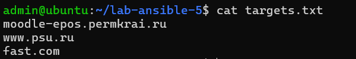
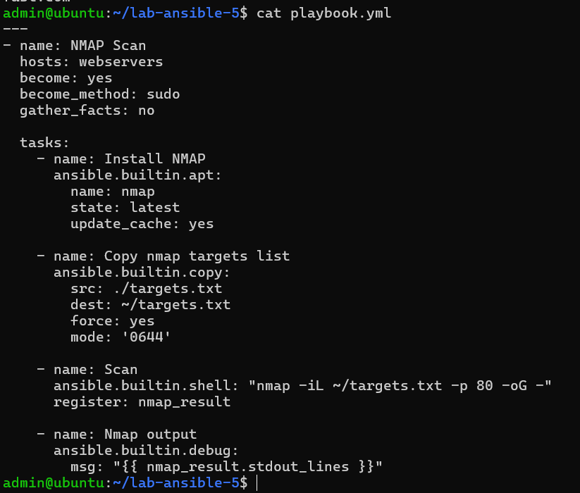
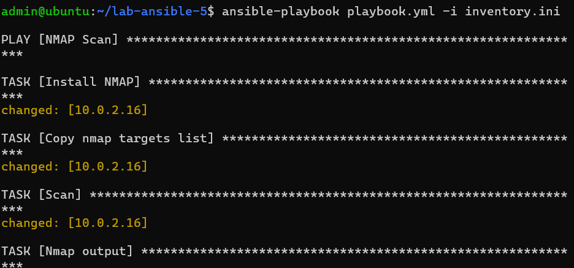
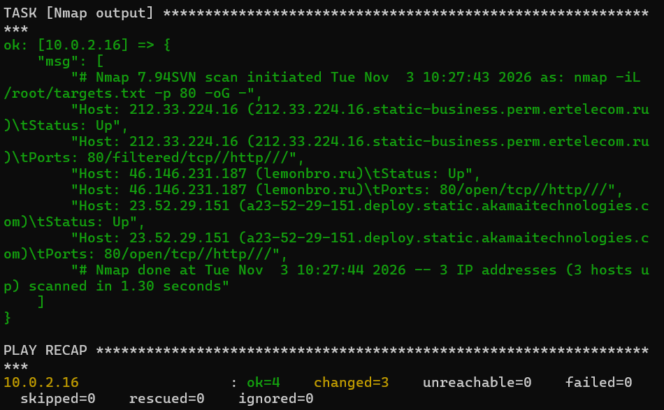

# Лабораторная работа №5: Работа с переменными в Ansible

**Студент:** Нечаева Полина  
**Группа:** ИТ-3,4  

## Цель работы
Изучить работу с переменными, циклами, регистрацией результатов и отладкой в Ansible. Создать playbook для установки сканера NMAP и сканирования списка целевых хостов с последующим выводом результатов.

## Выполненные задачи
1. Создан файл со списком целей для сканирования (`targets.txt`).
2. Написан playbook, который:
   - Устанавливает NMAP на целевой хост (Managed node).
   - Копирует список целей на сервер.
   - Запускает сканирование порта 80 с помощью модуля `shell`.
   - Регистрирует результаты выполнения в переменную (`register`).
   - Выводит результаты через модуль `debug`.
3. Playbook успешно выполнен, результаты сканирования получены и проверены.

## Структура проекта
- `targets.txt` — список целевых хостов для сканирования.
- `playbook.yml` — основной сценарий автоматизации.
- `inventory.ini` — файл инвентаризации с описанием целевого хоста.

## Ключевые концепции Ansible, использованные в работе
- **Variables** — переменные для хранения значений.
- **Register** — сохранение результатов выполнения команд в переменные (facts).
- **Debug** — вывод информации для отладки (`stdout_lines`).
- **Jinja2** — шаблонизатор для подстановки переменных (`{{ }}`).

## Демонстрация результатов

### 1. Список целей (targets.txt)

### 2. Сценарий автоматизации (playbook.yml)

### 3. Успешный запуск Ansible Playbook

### 4. Результаты сканирования (вывод debug)

